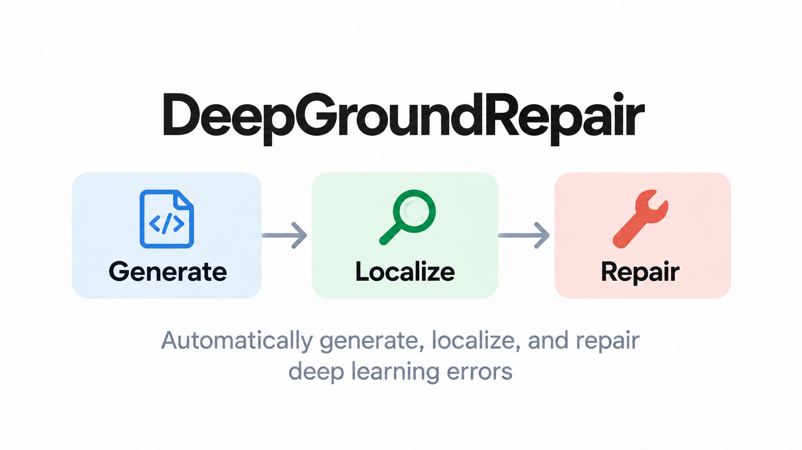
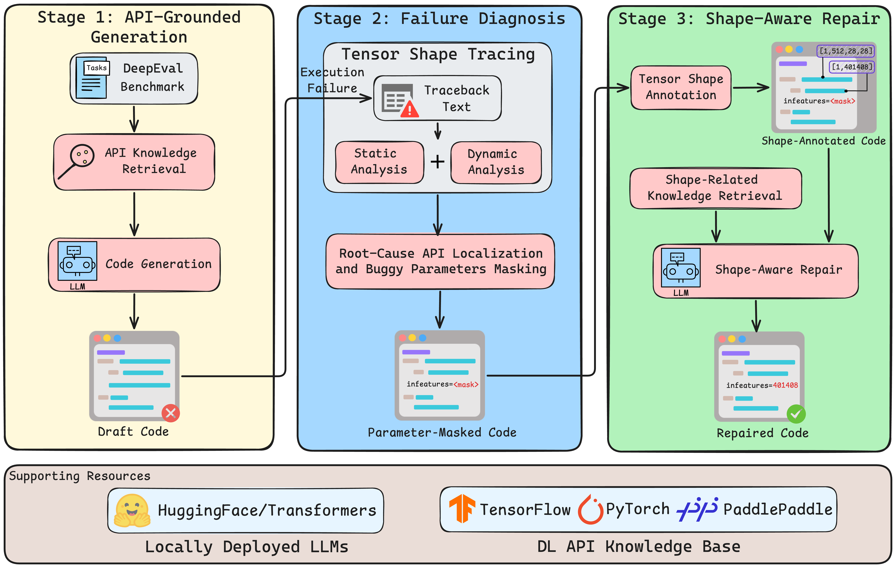
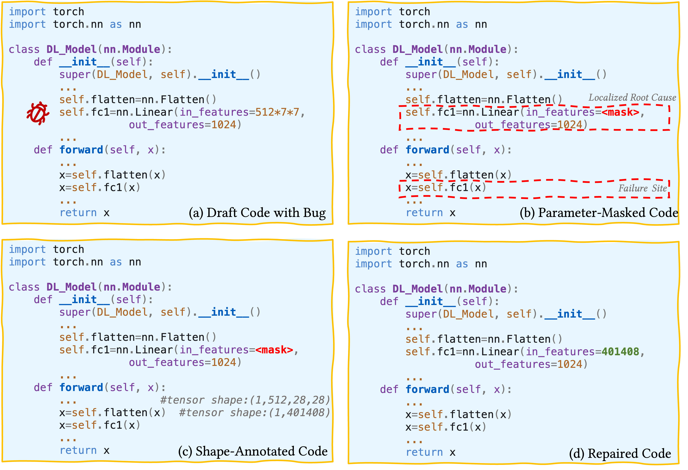

<p align="center">
  
</p>

# DeepGroundRepair

## 📘 Introduction
DeepGroundRepair is a tool for API-grounded generation, failure localization, and shape-aware repair of deep learning (DL) programs. It supports **TensorFlow, PyTorch, and PaddlePaddle**, and six open-weight LLMs from the **Gemma-3 and Mistral families**. Additional models can be integrated through configurable interfaces. The tool provides intermediate artifacts for inspecting each stage of the Generate → Localize → Repair workflow. 

<p align="center">
  
</p>

## 🎥 Demo Video
A demonstration video showcases the **Generate → Localize → Repair** workflow using a representative PyTorch tensor-shape mismatch.
<p align="center">
  <a href="https://youtu.be/pq7gUaa3C3s">
    
  </a>
</p>

## 🛠️ Environment Setup

Clone the repository and create the Conda environment:

```bash
git clone https://github.com/maxy-635/DeepGroundRepair.git
cd DeepGroundRepair
conda env create -f environment.yaml
conda activate deepcoderag
```

## 🚀 Run the Main Pipeline
### Stage 0: Configure a Run

**LLM Deployment.** Before running the pipeline, download the selected LLM checkpoint and tokenizer to a local Hugging Face cache. DeepGroundRepair loads models through the interfaces in `utils/` (e.g., `utils/chat2gemma.py`). Configure the cache path for Stage 1 in `step_one/retriever4generation.py` and for Stage 3 using `--cache_dir` in `run_bashes/step_three/run_main.sh`.

**API Retrieval Configuration.** DeepGroundRepair combines **BM25-based sparse retrieval** (`step_one/whoosh_search.py`) and **dense retrieval** using `BAAI/bge-m3` (`step_one/vector_store_manager.py`). Preconstructed API knowledge bases for the three supported DL libraries are available under `database/`.

**Execution Settings.** Before running the pipeline, configure the following parameters in the corresponding scripts under `run_bashes/`:

| Configuration | Example | Setting |
|---|---|---|
| Language model | `google/gemma-3-12b-it` | Model-loading interfaces and stage scripts |
| Target DL library | `PyTorch` | `--dlls` |
| Task collection | `DeepEval` | `--benchmark` (Stage 1) |
| Experiment ID | `example_run` | Stage scripts |
| Repeats | `1` | `--repeats` (Stage 1) |
| Repository path | `/path/to/DeepGroundRepair` | `PYTHONPATH` |

Use consistent model and experiment IDs across the three stages.


### Stage 1: API-Grounded Generation

Before running Stage 1, place the task requirements under `benchmark/DeepEval/` as YAML files. Each file must contain a `Requirement` field describing the code-generation task. Subdirectories under `benchmark/DeepEval/` are supported.

Configure `run_bashes/step_one/run_main.sh`, then run:

```bash
bash run_bashes/step_one/run_main.sh
```

Stage 1 retrieves and validates task-relevant APIs, then uses the verified API knowledge to generate draft code.

See [Stage 1 documentation](step_one/readme.md) for implementation-specific details.

| Output file | Path | Description |
| --- | --- | --- |
| `generated_code.py` | `response/<model>/step_one/<dl-library>/<task>/generated_code.py` | Generated DL program |
| `retrieval_api_list.json` | `evaluation/retrieval_accuracy/retreived_results/`<br>`<model>/step_one/<dl-library>/retrieval_api_list.json` | Recorded API retrieval results |
| Log file | `logs/<model>/step_one/<dl-library>/run.log` | Stage 1 execution details |


Example: [Stage 1 generated code](response/gemma_3_12b_it/step_one/pytorch/easy_task_2/generated_code.py). 


### Stage 2: Failure Localization
Stage 1 must have produced the expected input directory tree. Configure `run_bashes/step_two/run_main.sh`, then run:

```bash
bash run_bashes/step_two/run_main.sh
```

Stage 2 analyzes execution failures using traceback information. For tensor-shape mismatches, it combines static analysis and runtime tensor-shape information to identify root-cause API configurations and suspicious parameters. The resulting diagnostic artifacts guide parameter masking and subsequent repair.

See [Stage 2 documentation](step_two/README.md) for implementation-specific details.

| Output file | Path | Description |
| --- | --- | --- |
| `annotated_code.py` | `response/<model>/step_two/<dl-library>/<task>/annotated_code.py` | Annotated code for downstream repair |
| `annotated_code.json` | `response/<model>/step_two/<dl-library>/<task>/annotated_code.json` | Structured diagnostic information for downstream repair |
| Log file | `logs/<model>/step_two/<dl-library>/run.log` | Execution and diagnosis details |

Example: [Stage 2 annotated code](response/gemma_3_12b_it/step_two/pytorch/easy_task_2/annotated_code.py).

### Stage 3: Shape-Aware Repair

Stage 2 must have produced both `annotated_code.py` and `annotated_code.json`. Edit `run_bashes/step_three/run_main.sh`, then run:

```bash
bash run_bashes/step_three/run_main.sh
```

Stage 3 uses the localized root cause, traced tensor shapes, and relevant API knowledge to repair the generated program. The repaired program is then re-executed to validate the fix.

See [Stage 3 documentation](step_three/readme.md) for implementation-specific details.

| Output file | Path | Description |
| --- | --- | --- |
| `repaired_code.py` | `response/<model>/step_three/<dl-library>/<task>/repaired_code.py` | Candidate repaired program |
| Log file | `logs/<model>/step_three/<dl-library>/run.log` | Repair and re-execution details |

Example: [Stage 3 repaired code](response/gemma_3_12b_it/step_three/pytorch/easy_task_2/repaired_code.py).


## 🔍 Representative Demonstration

The following example illustrates a PyTorch tensor-shape mismatch and its repair through four intermediate artifacts:

1. **Draft code with bug.** The generated program contains `nn.Linear(in_features=512*7*7, out_features=1024)`. However, the preceding operations produce a tensor of shape `[1, 512, 28, 28]`, flattened to `[1, 401408]`. The mismatch appears at `self.fc1(x)`.
2. **Parameter-masked code.** Failure diagnosis traces the error back to the upstream `nn.Linear` constructor, identifies `in_features` as suspicious, and masks the original value.
3. **Shape-annotated code.** Runtime evidence records the transformation `[1, 512, 28, 28] → [1, 401408]`, which indicates the expected input-feature dimension.
4. **Repaired code.** Shape-aware repair replaces the incorrect `in_features` value with `401408` and re-executes the program for validation.

<p align="center">
  
</p>

## 📊 Evaluate Results

After completing the pipeline, configure the model, target DL library, stage, and experiment ID in the corresponding evaluation scripts. The following evaluation metrics are supported:

| Evaluation | Metric | Execution script |
| --- | --- | --- |
| Dynamic checking | Code Executability Rate | `bash evaluation/dynamic_checking/run.sh` |
| Static checking | API hallucinations and parameter misuses | `bash evaluation/static_checking/run.sh` |
| Semantic checking | Semantic Consistency Rate | `bash evaluation/semantic_consistency/run.sh` |
| Token costs | Token consumption | `bash evaluation/token_costs/run.sh` |

See the [Documentation Map](#documentation-map) for evaluator-specific settings and result locations.


## 📋 Experimental Environment

The experiments were conducted in the following environment:

| Component | Configuration |
|---|---|
| GPU | 2 × NVIDIA V100 |
| Operating System | CentOS 7.8 |
| Python | 3.10 |
| CUDA | 12.1 |
| cuDNN | 8.9.5 |
| TensorFlow | 2.16.1 |
| PyTorch | 2.11.0 |
| PaddlePaddle | 3.3.0 |


## Documentation Map

- [Stage 1: API-Grounded Generation](step_one/readme.md)
- [Stage 2: Failure Diagnosis](step_two/README.md)
- [Stage 3: Shape-Aware Repair](step_three/readme.md)
- [Dynamic checking](evaluation/dynamic_checking/readme.md)
- [Static checking](evaluation/static_checking/readme.md)
- [Semantic consistency](evaluation/semantic_consistency/readme.md)
- [Token costs](evaluation/token_costs/readme.md)


## 📚 Citation
The associated research paper is currently under review at ACM Transactions on Software Engineering and Methodology (TOSEM).

If you use DeepGroundRepair in your research, please cite the following preprint:

```bibtex
@misc{ma2026deepgroundrepair,
      title={DeepGroundRepair: From API-Grounded Generation to Shape-Aware Repair for Deep Learning Programs}, 
      author={Xiangyue Ma and Zhen Wang and Xuhui Lu and Xiaoting Du and Chenglong Li and Jun Li and Haotian Li and Zheng Zheng},
      year={2026},
      eprint={2610.16897},
      archivePrefix={arXiv},
      primaryClass={cs.SE},
      url={https://arxiv.org/abs/2610.16897}, 
}
```
